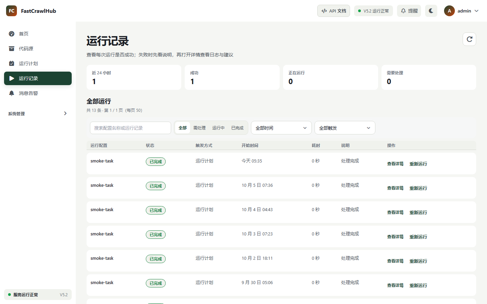
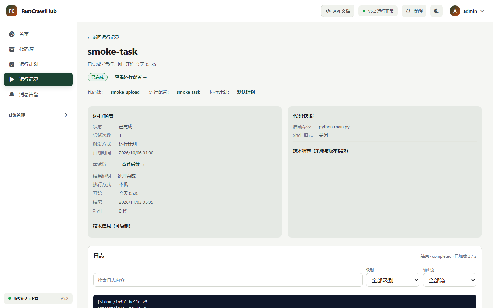

# FastCrawlHub

> 让自动化代码，按计划运行。

FastCrawlHub 是面向爬虫、数据任务和自动化脚本的自托管运行平台。它把代码版本、运行计划、执行节点、日志与构件放在同一个可追踪的工作面上。

[官网](https://fast-crawl.com) · [快速开始](https://fast-crawl.com/docs/quick-start) · [部署指南](https://fast-crawl.com/docs/install) · [API 文档](https://fast-crawl.com/docs/api)



## 为什么使用 FastCrawlHub

- **固定代码版本**：每次运行绑定明确版本，结果可以复现。
- **计划与节点调度**：按计划触发，并在已配置的执行节点上运行。
- **日志与构件留档**：集中保留运行状态、完整日志和输出构件。
- **部署在自己的环境里**：支持 Windows 本地版与 Linux Docker 版。

## 一次运行，从代码到结果

```text
代码源 → 固定版本 → 运行任务 → 执行节点 → 日志与构件
```



## 5 分钟了解产品

1. 阅读[快速开始](https://fast-crawl.com/docs/quick-start)。
2. 按环境选择 [Windows 本地版或 Linux Docker 版](https://fast-crawl.com/docs/install)。
3. 接入代码，创建运行配置并完成第一次运行。

仓库中的 [`examples/hello-task`](examples/hello-task) 是一个最小示例任务，可用于验证日志与构件收集流程。

## 仓库定位

这是 FastCrawlHub 的公开展示与社区入口，包含：

- 产品文档与使用示例
- 公开路线图与发行说明
- Bug 反馈和功能建议
- 可公开复用的任务示例

FastCrawlHub 产品核心源码、授权服务和内部部署设施不在此仓库中。本仓库公开不代表核心产品采用开源许可证；具体权利说明见 [NOTICE](NOTICE.md)。

## 反馈

- 发现问题：提交 Bug Issue
- 功能建议：提交 Feature Request
- 安全问题：请不要公开披露，按照[安全策略](SECURITY.md)联系维护者

## 当前版本

FastCrawlHub V5.2 正在进行发布准备。进度见[公开路线图](ROADMAP.md)。

